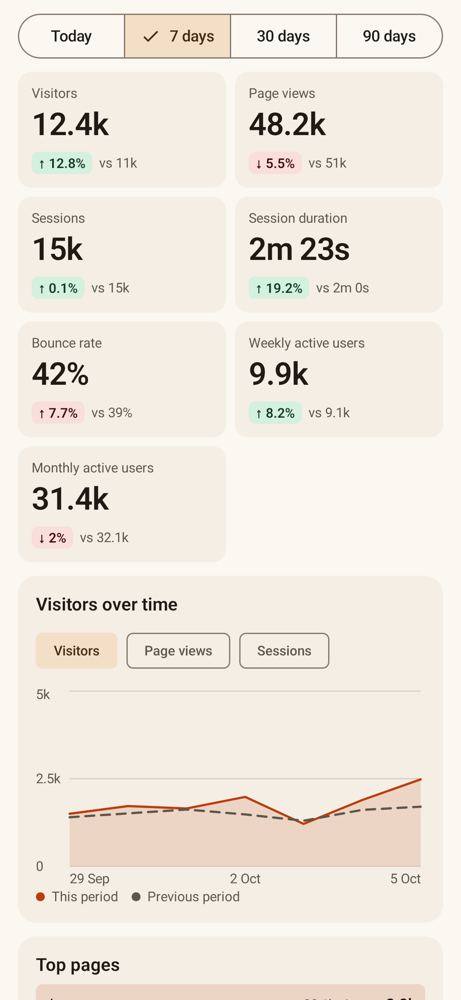
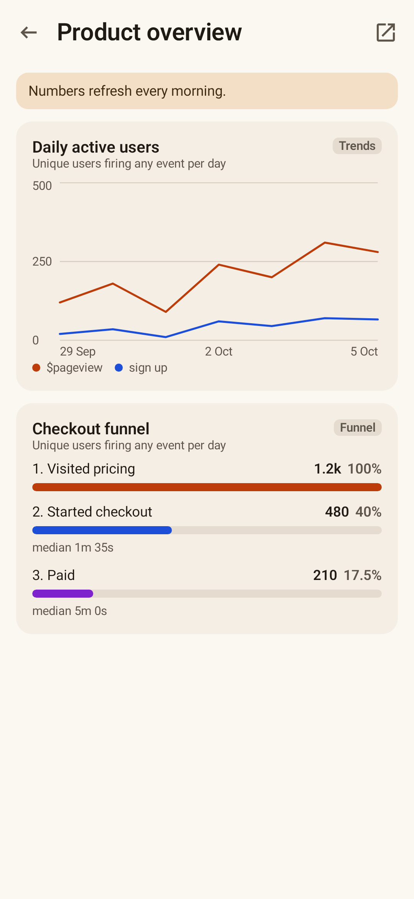
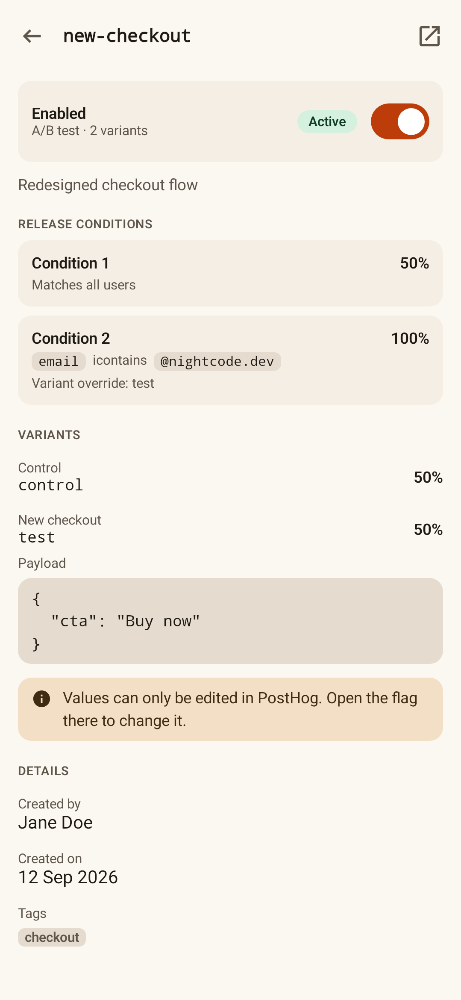
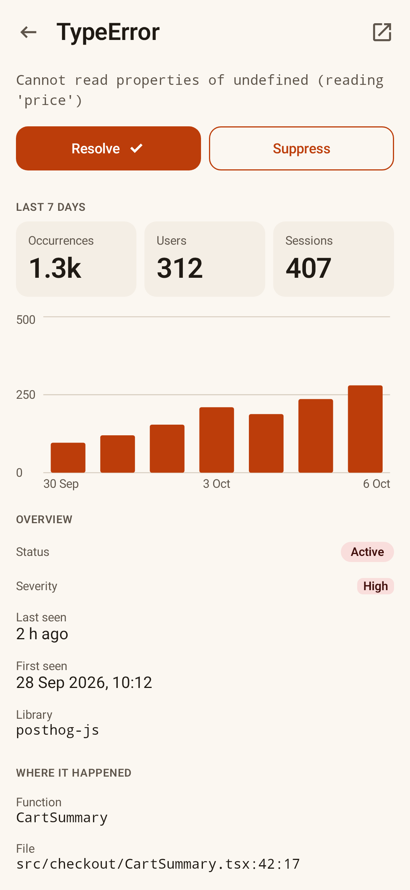
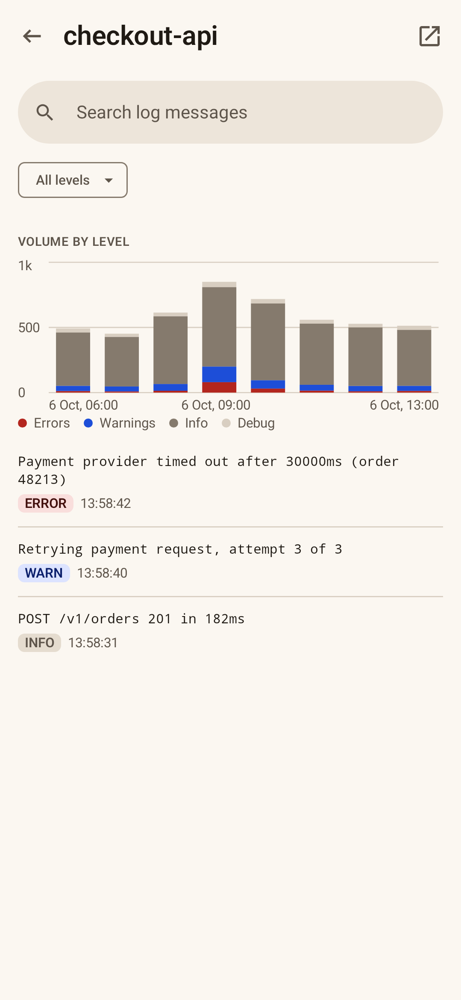

<div align="center">


# Snout

**Pocket-sized PostHog.**<br>
Your analytics, dashboards, feature flags, errors and logs, in a native Android and iOS app.

[](https://github.com/ikurek/snout/actions/workflows/quality-gate.yml)
[](LICENSE)
[](https://kotlinlang.org)
[](https://www.jetbrains.com/compose-multiplatform/)


[](CONTRIBUTING.md)







</div>

Snout is an open-source, unofficial PostHog client built with Kotlin Multiplatform and Compose Multiplatform. It
connects straight to your PostHog instance (US or EU cloud, or self-hosted) with a personal API key. It has no
backend of its own: your PostHog data travels only between your device and the instance you configure. The release
builds the project publishes send anonymous usage and error reports to Snout's own PostHog project, which never include your PostHog data and can
be switched off in Settings → Privacy (see the [privacy policy](PRIVACY.md)).

> [!NOTE]
> Snout is a community project. It is not affiliated with or endorsed by PostHog Inc.

## Features

- **Analytics**: web analytics overview (visitors, page views, sessions, duration, bounce rate) with
  period-over-period deltas, a visitors trend and top pages / sources / countries / devices for today, 7, 30 or 90 days.
- **Dashboards**: list of project dashboards, pinned first; open one to see every tile rendered natively
  (trends as line or bar, bold numbers, pie/donut, funnels, SQL tables). Tiles PostHog has not cached yet are computed on demand.
- **Insights**: saved insights with server-side search, favorites, and a detail view with the chart and metadata.
- **Feature flags**: search, status, rollout conditions and variants. Toggle a flag on or off with a confirmation;
  a key without the write scope gets a clear explanation instead of a failure.
- **Errors**: error tracking issues with search, an active / resolved / suppressed filter and an app version filter
  (versions that reported exceptions this week), each with its occurrences, users and a 7-day sparkline; open one
  for its impact chart, where it happened and the latest release, and resolve, suppress or reopen it with undo.
  Instances without the error tracking API get an "unavailable" state.
- **Logs**: services sending OpenTelemetry logs to PostHog with their volume, error rate and a sparkline for the
  last hour, day or week; open one for its latest lines with search, a level filter and older pages on scroll, and
  tap a line for its full message, trace ID and attributes.
- **Experiments**: status, variants, metrics and conclusion (read-only).
- **Annotations**: timeline of project annotations and a sheet to add one.
- **Activity log**: who changed what in the project, with before/after values.
- **Settings**: account, instance, selected project, light/dark/system theme, log out. Customise which four
  sections sit in the bottom bar (the rest live under More) and which opens first, and what the Analytics
  tab shows: default range, stat cards, visitors chart and breakdown tables. An open-source libraries screen lists
  every bundled library with its version, author and license, and opens each for its full license text and website.
  A Privacy screen switches usage and error reports off and links the privacy policy.
- Every screen that loads from PostHog has loading, empty, error, permission-denied and rate-limited states, pull to
  refresh and an "open in PostHog" action.

## Getting started

Snout isn't in the app stores yet; build it from source (see [Building](#building)).

1. In PostHog, open **Settings → Personal API keys** and create a key with the scopes below.
2. Open Snout, enter your instance URL and paste the key. It is kept encrypted on the device (Keychain on iOS,
   Keystore on Android) and only ever sent to that instance.
3. Pick an organization and project. You can switch project at any time.

### Personal API key scopes

Read: `user`, `organization`, `project`, `dashboard`, `insight`, `query`, `feature_flag`, `experiment`,
`annotation`, `activity_log`. Add `error_tracking:read` for Errors and `logs:read` for Logs. Add `feature_flag:write` to toggle flags,
`annotation:write` to add annotations, `error_tracking:write` to resolve or suppress errors and `insight:write`
to favorite insights. The login screen lists which scope each feature needs.
PostHog rate-limits personal keys (for example 240 requests a minute and 1,200 an hour on analytics endpoints); the
app surfaces this instead of failing silently.

## Building

You need JDK 17 or newer, Android Studio (or the Android SDK) and, for iOS, a Mac with Xcode.

```
./gradlew :androidApp:assembleDebug            # Android debug APK
open iosApp/iosApp.xcodeproj                   # iOS: run from Xcode, Gradle builds the shared framework
```

If Gradle cannot find the Android SDK, add a `local.properties` with `sdk.dir=/path/to/Android/sdk`.

## Contributing

Bug reports, ideas and pull requests are welcome. Read [CONTRIBUTING.md](CONTRIBUTING.md) for the workflow and
checks, and [docs/ARCHITECTURE.md](docs/ARCHITECTURE.md) for how the code is laid out and the conventions it
follows. Please report security issues privately as described in [SECURITY.md](SECURITY.md), and follow the
[Code of Conduct](CODE_OF_CONDUCT.md) in all project spaces.

## License

Snout is licensed under the [Apache License 2.0](LICENSE). Copyright 2026 [The Snout Authors](AUTHORS).

PostHog is a trademark of PostHog Inc. Snout uses the name only to say which service it connects to.
